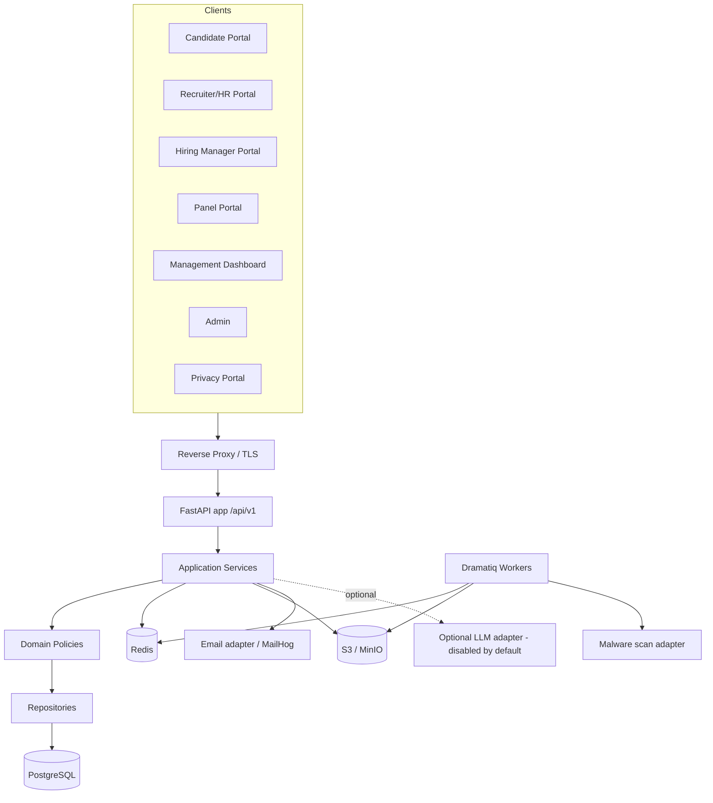
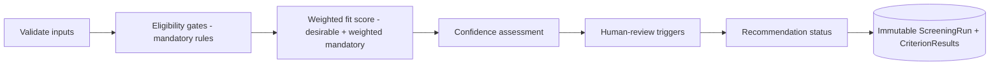
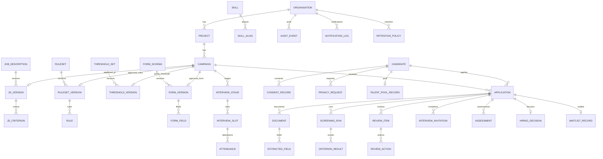

# Design — Orient Recruitment Accelerator

## Overview

This design realises the requirements in `requirements.md` as a secure, explainable,
deterministic recruitment platform built as a **modular monolith** (FastAPI backend,
React/TypeScript frontend, PostgreSQL, Dramatiq/Redis workers, S3-compatible storage).
The defining design constraints are: deterministic version-controlled screening, immutable
approved versions and screening runs, strict layering with mandatory choke points
(Screening Service, Transition Service, Audit outbox), object-level authorisation, and
runtime independence from any LLM and from Kiro.

The design maps every requirement section to concrete components. Steering files in
`.kiro/steering/` are the normative source for cross-cutting rules; this document shows how
they are implemented.

## Architecture

### High-level



### Layering (enforced)

`router -> service -> policy -> repository -> db`. Routers do auth + (de)serialization
only. ORM models never leave the repository layer; services return Pydantic schemas.
Modules depend on each other only through service interfaces registered via dependency
injection, avoiding circular imports.

### Mandatory choke points

- **ScreeningService** — the only path that produces a `ScreeningRun`. (Req 8)
- **TransitionService** — the only path that mutates campaign or application status. It
  consults the transition table, checks permission + object-level authz + required data +
  required approval, writes the new state, and emits an audit event atomically. (Req 2.3)
- **AuditService (outbox)** — every service writes audit events through a transactional
  outbox so audit and state change commit together. (Req 13)

## Components and Interfaces

### Backend module responsibilities

| Module | Responsibility | Key requirements |
|---|---|---|
| Identity & Access | AuthN, tokens, MFA scaffold, permissions, roles, object-level authz | 1.1, 1.2, 1.3 |
| Organisations | Org/tenant key, org settings | DB scoping |
| Projects | Project CRUD | 2.1 |
| Campaigns | Campaign CRUD, lifecycle via TransitionService, publication gating | 2.2, 2.3, 2.4 |
| Job Descriptions | JD upload intake, versions (immutable), criteria, re-version flow | 3.1–3.3 |
| Rules | Typed-JSON rules, validation, approval, versioning, SoD | 7.1, 7.2 |
| Candidates | Canonical candidate, consent state, duplicate/merge history | 5.2, 5.4 |
| Applications | Per-campaign application, snapshotted answers, disposition via TransitionService | 5.1, 5.2, 10.4 |
| Documents | Validation, quarantine, signature/MIME checks, hashing, signed links | 3.1, 5.3, 16.1 |
| Extraction | Pluggable parser adapters, OCR fallback, confidence, evidence spans | 5.3 |
| Screening | Deterministic pipeline, immutable runs, explainable score | 8.1–8.3 |
| Human Review | Review queue, reviewer actions, correction records | 9.1 |
| Interviews | Approval, invitations, stages | 10.1, 10.3 |
| Walk-in Slots | Slots, capacity, attendance | 10.2 |
| Assessments | Structured assessment forms | 10.3 |
| Hiring Decisions | Select/reject/hold/withdraw recommend+approve | 10.4 |
| Waitlists | Waitlist records, expiry | 11.1 |
| Talent Pool | Separate consent, rediscovery with human verification | 11.3 |
| Notifications | Provider-neutral adapter, template versions, delivery tracking | 12.1 |
| Reporting | HR + management dashboards, small-group suppression | 15.1, 15.2 |
| Privacy | Consent, privacy requests, retention, anonymisation, legal hold | 14.1, 14.2 |
| Audit | Append-only events, integrity hash | 13.1 |
| System Administration | Users, roles, system config | 1.2 |

### Rules engine

A pure, side-effect-free evaluator over a typed JSON AST.

- **Validation phase (at authoring/approval):** parse JSON into a typed node tree; reject
  unknown node types, unknown operators, type mismatches, or malformed structure. Only a
  whitelisted operator set is accepted (`eq, neq, gte, gt, lte, lt, in, contains_verified`).
- **Evaluation phase (at screening):** interpret the validated tree against a normalised
  candidate evidence set. No `eval`/`exec`, no stored code, no SQL. Deterministic and
  reproducible given `(input_hash, rule_set_version, engine_version)`.
- **Node types:** boolean, numeric_comparison, numeric_range, text_enum, exact_skill,
  skill_experience, verified_certification, education, location, notice_period,
  relevant_experience, evidence_present, confidence_threshold, and groups and/or/not.
- Each node yields `pass | fail | manual_review`, `awarded`/`max`, `evidence_refs`, and a
  `reason` string. `missing_evidence` and `low_confidence` behaviours are configured per
  rule and default to `manual_review`.

Rule DSL example (illustrative, synthetic):

```json
{
  "rule_id": "RULE-VMWARE-001",
  "version": 1,
  "name": "Minimum VMware experience",
  "criterion_type": "skill_experience",
  "skill_id": "SKILL-VMWARE",
  "operator": "gte",
  "expected_value": 3,
  "unit": "years",
  "mandatory": true,
  "weight": 20,
  "missing_evidence": "manual_review",
  "low_confidence": "manual_review"
}
```

### Screening pipeline



- Inputs: approved JD version, approved rule-set version, active threshold version,
  approved form version, current extraction version, candidate-entered + verified evidence.
- Mandatory-not-confirmed does **not** auto-reject; it produces an outcome status and, when
  caused by missing/low-confidence/conflicting evidence, routes to human review.
- The run stores an `input_data_hash` and `engine_version` for reproducibility.

### Document & extraction pipeline


Adapters: `MalwareScanner`, `DocumentParser` (per type), `OcrEngine`, `ObjectStore`,
`EmailProvider`, `AuthProvider`, `LlmAdapter` (optional, disabled). All behind interfaces
for substitution (ADR-0004, ADR-0005, ADR-0013, ADR-0014).

### Authorisation model

- Permissions are first-class; roles are bundles (Req 1.2).
- Every endpoint declares required permission(s). A dependency resolves the actor's
  effective permissions and then performs **object-level authz** against the target
  campaign/application assignment set.
- Separation-of-duties checks live in domain policies (e.g. `RulePolicy.can_approve`
  rejects creator-as-sole-approver; `ThresholdPolicy.require_four_eyes`).

## Data Models

Common mixin columns on all tables: `id UUID PK`, `organisation_id`, `created_at`,
`updated_at` (UTC), `created_by`, `updated_by`, `version` (optimistic lock where mutable).

### ER overview



### Immutability & concurrency

- `JD_VERSION`, `RULESET_VERSION`, `THRESHOLD_VERSION`, `SCREENING_RUN`, and
  `CRITERION_RESULT` are append-only once approved/completed. Edits create new versions.
- Mutable aggregates (Campaign, Application, Candidate) use optimistic concurrency via
  `version` / ETag.
- `EXTRACTED_FIELD` stores verified vs unverified separately; corrections create
  `REVIEW_ACTION` records (original + corrected + reason + actor + ts) and never overwrite
  the extracted source value.

### Key field notes

- `ScreeningRun` carries all version pointers + `input_data_hash` + `engine_version` for
  reproducibility (Req 8.1.3).
- `AuditEvent` carries previous/new-state references + `integrity_hash` (prev-hash chain)
  (Req 13.1.2).
- `ConsentRecord` distinguishes application consent from talent-pool consent (Req 11.3).

## API Design

- Base `/api/v1/`; groups per `steering/api-standards.md`.
- Pydantic request/response models; consistent error envelope with correlation id;
  pagination, explicit filtering, whitelisted sort fields.
- Idempotency keys on: create campaign, submit application, execute screening, change
  threshold, issue interview invitation.
- Optimistic concurrency via ETag/`version` on mutable resources.
- Every endpoint documents required permission(s); OpenAPI generated by FastAPI.

## State Transition Models

### Campaign (guards summarised; full table in docs/state-machines.md)

| From | To | Permission | Required data/approval |
|---|---|---|---|
| Draft | JD Uploaded | jd.upload | validated JD file |
| JD Uploaded | JD Review | jd.review | extracted draft |
| JD Review | Criteria Configuration | jd.approve | approved JD version |
| Criteria Configuration | Criteria Review | rule.create | ruleset draft |
| Criteria Review | Approval Pending | rule.approve | approved ruleset (SoD) |
| Approval Pending | Approved | campaign.approve | JD+rules+form+threshold+privacy present |
| Approved | Published | campaign.publish | all prerequisites (AC-04) |
| Published | Applications Open | (schedule) | opening date reached |
| Applications Open | Paused / Applications Closed | campaign.pause | reason |
| Applications Closed | Screening | screening.execute | approved rule version |
| Screening | Human Review | application.review | review items generated |
| Human Review | Interview Planning | interview.approve | invitation approval |
| Interview Planning | Interviewing | interview.schedule | slots assigned |
| Interviewing | Selection Review | assessment.submit | assessments present |
| Selection Review | Completed | hiring_decision.approve | decision approved |
| Completed | Closed -> Archived | campaign.edit | — |
| (various) | Cancelled | campaign.edit | reason |

Any transition not listed is rejected (Req 2.3.3).

### Application / disposition
Submitted → DocumentsProcessing → ExtractionReview → Screened → {ManualReview ↔ Screened} →
InterviewRecommended → InterviewScheduled → {Attended|NoShow} → Assessed →
{Selected|Rejected|Hold}; plus Waitlisted, Withdrawn, AdditionalInfoRequested. All via
TransitionService.

## Error Handling

- Consistent envelope `{ "error": { "code", "message", "correlation_id", "details"? } }`.
- No internal details or PII leaked in error messages (sanitised).
- Explicit exception types per domain; never swallow exceptions; validation errors mapped
  to 422 with field-level details for forms.
- Upload/scan failures route files to quarantine state, never to processing.

## Security Design

Implements `steering/security.md`. Highlights: Argon2id, short-lived tokens + protected
refresh, HttpOnly/Secure/SameSite cookies + CSRF, rate limiting + lockout + anomaly logs,
object-level authz server-side, parameterised DB access, output encoding, CSP/HSTS/security
headers, restricted CORS, egress allow-list (SSRF), signed short-lived download links, upload
validation + quarantine + malware scan + zip-bomb limits + metadata stripping, CSV formula
neutralisation, PII-safe logging, secrets from environment. Full threat model in
`docs/threat-model.md`.

### AI safety
JDs/resumes are untrusted data; their text can never override instructions or trigger
tools/queries/code. The optional LLM adapter is disabled by default, schema-validates
output, stores provider/model/prompt-template versions, and is advisory only with a
deterministic fallback (`steering/responsible-ai.md`).

## Observability

Structured JSON logs with correlation id and no candidate PII; metrics; tracing readiness;
`/health` and `/ready` endpoints.

## Testing Strategy

Per `steering/testing.md`: domain/unit, rules-engine determinism + regression,
state-transition, permission + object-level authz, repository, API integration, migration,
document-validation, audit, privacy, retention; frontend component/form/permission/a11y/
workflow/error tests; e2e for the full lifecycle; security tests (privilege escalation,
IDOR, malicious files, injection, XSS, CSRF, rate limit, token expiry, tenant isolation,
CSV injection, prompt injection). Rules regression proves determinism, versioning, and
reproducibility of old results.

## Deployment Design

Docker Compose for local (API, worker, PostgreSQL, Redis, MinIO, MailHog, reverse proxy).
Environment-based config validated at startup. Production gates per `steering/devsecops.md`.
Backup/restore and clean-environment bootstrap documented in `docs/`.

## Traceability (requirement -> design)

- Req 1.* -> Identity & Access module, authorisation model, SoD policies.
- Req 2.* -> Projects/Campaigns modules, TransitionService, publication gating.
- Req 3.* -> Job Descriptions + Documents + Extraction modules, immutable JD versions.
- Req 4.* -> Form schema versions, excluded-fields enforcement.
- Req 5.* -> Candidates/Applications separation, document & extraction pipeline.
- Req 6.* -> Skill taxonomy tables, related-not-equivalent rule.
- Req 7.* -> Rules engine (validation + evaluation), versioning, SoD.
- Req 8.* -> Screening pipeline, immutable ScreeningRun, explainable CriterionResult.
- Req 9.* -> Human Review queue + ReviewAction correction records.
- Req 10.* -> Interviews/Slots/Assessments/Hiring Decisions modules + approval guards.
- Req 11.* -> Waitlist, controlled re-evaluation, talent pool + separate consent.
- Req 12.* -> Notifications adapter + logs.
- Req 13.* -> Audit append-only + integrity hash.
- Req 14.* -> Privacy module, retention policies/actions.
- Req 15.* -> Reporting module + small-group suppression.
- Req 16.* -> Cross-cutting security, AI-optional operation, deploy/backup/restore, synthetic data.

## Open design decisions
Mirror `requirements.md` Open Decisions: field-level encryption mechanism, audit
tamper-evidence (default prev-hash chain), re-evaluation approval granularity (default
per-run), first SSO protocol, production OCR licensing posture. ADRs capture rationale.
