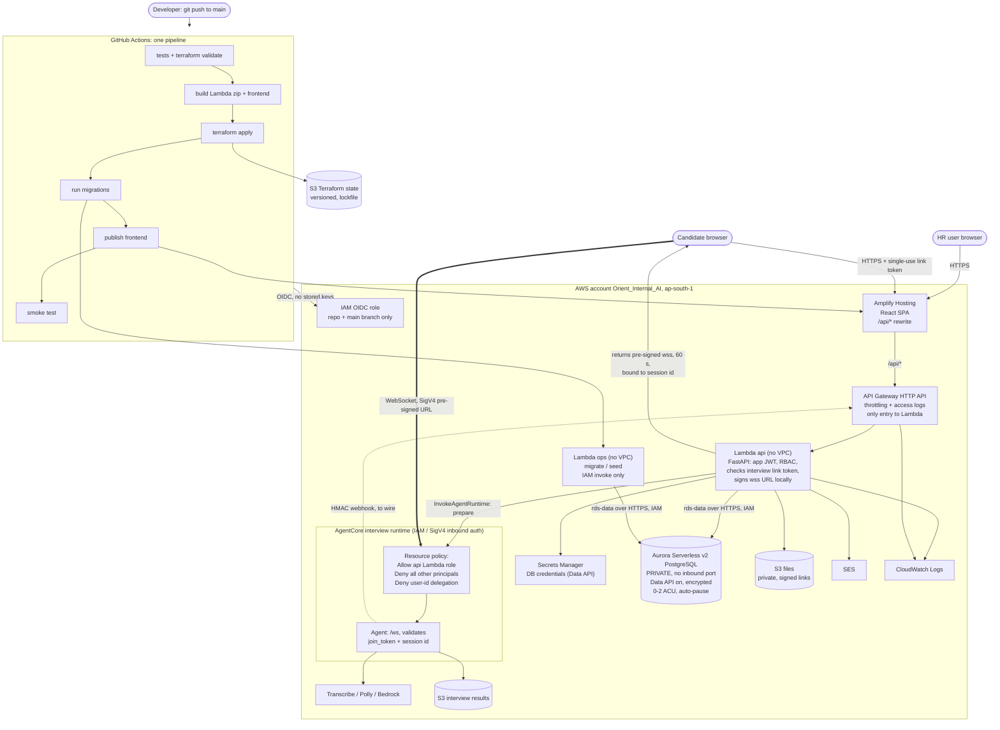

# HR Accelerator: AWS architecture v2 (no VPC, no NAT)

Account `Orient_Internal_AI`, region `ap-south-1`.

Change from v1: Lambdas run outside a VPC and reach a private Aurora cluster through the RDS Data API (IAM-signed HTTPS). No NAT, no Elastic IP, no open database port. Saves about $8-9 a month.

## Security model
- **Entry point:** API Gateway is the only path to the `api` Lambda. No Lambda Function URL exists.
- **Database:** Aurora has no public address and no inbound rule. Only IAM principals with `rds-data` permission on this cluster can run queries, and CloudTrail records the calls.
- **`ops` Lambda:** migrations and seeding only. No public URL, IAM invoke only.
- **Agent auth:** the interview runtime uses IAM (SigV4) inbound auth. A runtime supports IAM or JWT, not both. Candidates connect with a 60-second pre-signed `wss://` URL minted by the `api` Lambda after it checks their single-use link token.
- **Runtime lock:** `scripts/lock-agent-runtime.ps1` allows only the `api` Lambda role and denies every other principal.
- **CI/CD:** one GitHub Actions pipeline using OIDC, no stored AWS keys.
- **Cost tags:** Project, Application, Environment, Owner, CostCenter and ManagedBy on every resource.

## Expected monthly cost (estimate, unverified, +/-25%, Rs95 per USD)

| Item | USD/month |
|---|---|
| Amplify Hosting | 1-3 |
| API Gateway HTTP API (about $1 per million requests) | 0-1 |
| Lambda (api + ops) | 0-1 |
| Aurora Serverless v2, auto-paused when idle | 5-20 |
| Aurora storage and backups (about 5 GB) | ~1 |
| Secrets Manager (1 secret) | ~0.5 |
| S3 (files, artifacts, state) | 0.5-1 |
| CloudWatch Logs | 1-3 |
| SES | ~0 at low volume |
| AgentCore idle | 0 |
| **Fixed total** | **about $9-31, roughly Rs850-2,950** |

Per 5-minute AI interview (Transcribe, Polly, Bedrock): about Rs8-12.

## Risks to verify before switching from v1
- **Data API compatibility:** whether the app's SQLAlchemy code (UUID, JSONB, transactions) and Alembic migrations work through the Data API driver. This needs a spike against a real cluster.
- **Data API limits:** responses over 1 MB and statements over about 45 seconds fail. Large queries and exports need pagination.
- **Data API pricing:** believed to have no extra charge, not confirmed.
- **Latency:** each query is an HTTPS call, so a bit slower than a direct connection.

## Fallback
If the spike fails, v1 (`architecture.md`) stays valid: Lambdas in a VPC with a fck-nat instance, about $8-9 a month more. The Terraform in `terraform/` still implements v1.

## Not yet done
- The agent-to-HR-API result webhook is not wired.
- Cognito login and a gateway JWT authorizer are a later phase.
- Nothing is deployed.
