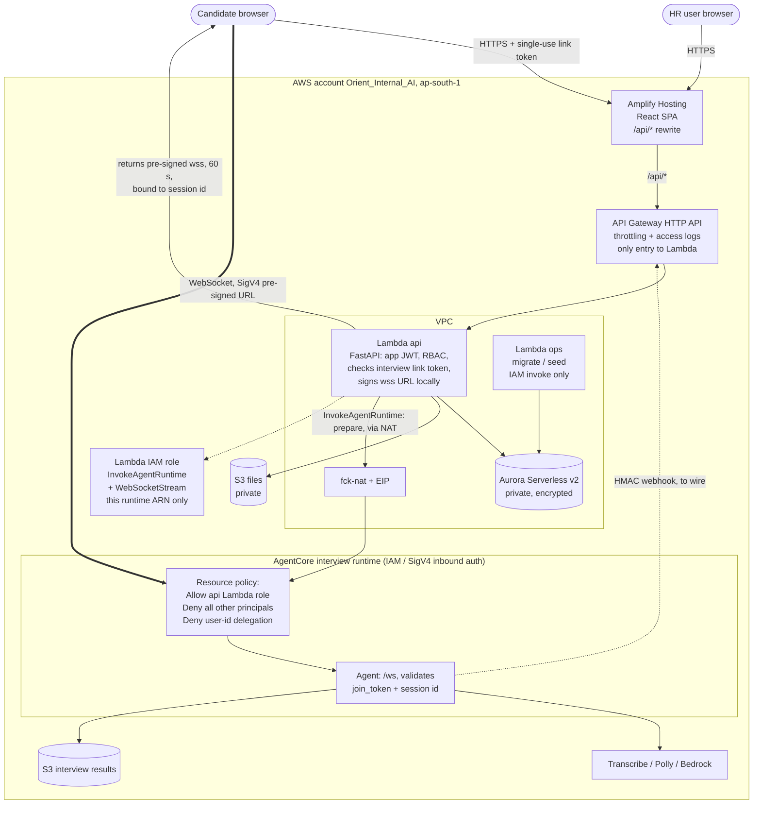

# HR Accelerator: AWS architecture (Orient_Internal_AI account, ap-south-1)

## Notes
- **Entry point:** API Gateway is the only way to reach the `api` Lambda. There is no Lambda Function URL.
- **`ops` Lambda:** runs migrations and seeding. No public URL, IAM invoke only.
- **Agent auth:** the interview runtime uses IAM (SigV4) inbound auth. A runtime supports IAM or JWT, not both. Candidates connect with a 60-second SigV4 pre-signed `wss://` URL minted by the `api` Lambda after it checks their single-use link token.
- **Runtime lock:** `scripts/lock-agent-runtime.ps1` attaches a resource policy that allows only the `api` Lambda role and denies every other principal.
- **Cost tags:** every resource carries Project, Application, Environment, Owner, CostCenter and ManagedBy.
- **CI/CD:** one GitHub Actions pipeline (`.github/workflows/deploy-orient-internal-ai.yml`) deploys infrastructure, backend, migrations and frontend.

## Not yet done
- The agent-to-HR-API result webhook is not wired.
- The Terraform still has the VPC and NAT. The Data API and Cognito changes are a later phase.
- Nothing is deployed yet.
