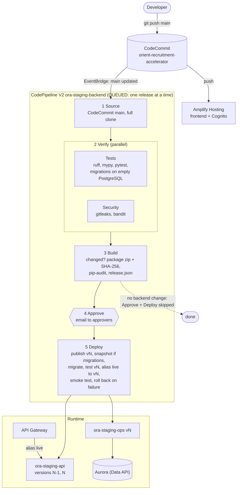

# Backend release pipeline (CodeCommit -> CodePipeline -> CodeBuild)

Account `Orient_Internal_AI` (917511768830), region `ap-south-1`. Pipeline `ora-staging-backend`.
Defined in `terraform-pipeline/` (applied locally). Stage logic in `buildspec/` and `pipeline/`.

**The pipeline releases Lambda code only.** Infrastructure (Aurora, API Gateway, IAM, S3, Lambda configuration)
is Terraform in `terraform/`, applied by hand from a developer machine. No pipeline role can create or change
infrastructure, and the pipeline cannot change itself.

## 1. Flow



## 2. Stages

| Stage | What runs | Fails when |
|---|---|---|
| **Source** | CodeCommit `main`, full clone (so Build can diff). Started by an EventBridge rule on every push. | |
| **Verify / Tests** | `ruff check app tests`, `mypy app` (strict), `pytest` (backend suite), then `alembic heads` + `alembic upgrade head` on a throwaway PostgreSQL 16 in the build container | any check fails, more than one Alembic head, a migration fails |
| **Verify / Security** | `gitleaks` on the committed tree with the repo's `.gitleaks.toml` (binary pinned and checksum-verified), `bandit` on `backend/app` (medium+ severity and confidence) | a secret or a security finding |
| **Build** | Diffs against the last released commit (SSM `/ora-staging/release/last-commit`). If runtime files changed (`backend/app/`, `backend/alembic/`, `alembic.ini`, `pyproject.toml`, `lambda-extra-requirements.txt`): builds the Lambda zip deterministically, records its SHA-256, runs `pip-audit` on the exact package. Writes `release.json`. | build error; `pip-audit` findings only if `pip_audit_enforce = true` |
| **Approve** | Manual approval. SNS email with the commit, changed-file count, new migrations, dependency findings. | rejected (nothing has changed in AWS) |
| **Deploy** | `pipeline/release.py`, see section 3 | any step fails (see rollback) |

Approve and Deploy are **skipped** when the commit changes no runtime file (frontend, docs or tests only), so those
commits never ask for approval. To release without a code change (e.g. after a Lambda configuration change in
Terraform), start the pipeline with `FORCE_RELEASE=true`: `scripts\release-api.ps1 -Force`.

Not gates yet: `ruff format --check` (137 existing files are unformatted) and `pip-audit` (see section 6).

## 3. Deploy order and automatic rollback

1. Upload `lambda.zip` to `s3://ora-staging-artifacts-<account>/releases/<commit>/lambda.zip`.
2. Update the code of `ora-staging-ops` and `ora-staging-api`, verify Lambda's `CodeSha256` equals the built zip,
   publish **version N** of each (description `commit <sha>`).
3. If the release adds migrations (or the previous release is unknown): Aurora cluster snapshot
   `ora-pre-<sha>-<time>`, wait until available.
4. Migrate with **ops version N** (`{"action": "migrate"}`).
5. Invoke **api version N** directly with a synthetic `GET /health`; expect 200. Live traffic is still on N-1.
6. Point alias `live` (API Gateway's target) to version N.
7. Public smoke test: `GET /health` = 200 and `GET /api/v1/auth/me` = 401, up to 6 tries.
8. If step 7 fails: alias `live` goes back to N-1 and the release fails.
9. Record the released commit in SSM.

A failure in steps 1-5 leaves live traffic untouched on N-1.

## 4. Rollback

| What | How | Time |
|---|---|---|
| API code | `scripts\rollback-api.ps1` (previous version) or `-Version <n>`. Published versions keep their own code. | seconds |
| Infrastructure | `git revert`, then `terraform apply` locally. State is versioned in S3. | minutes |
| Frontend | Amplify console: redeploy an earlier build, or `git revert` + push. | minutes |
| Database schema | No automatic down-migrations. Fix forward with a new migration; last resort: restore the `ora-pre-*` snapshot to a new cluster (restores data to that moment). | one release |

After a manual rollback, revert or fix the bad commit before the next push: the next release moves `live` forward.

## 5. Migration rules (expand / contract)

Code rolls back in seconds; the schema does not. Every migration must keep the **previous** version working:
- One release: add tables, nullable columns, columns with defaults, indexes.
- Two releases: rename or remove a column (add the new one and write both; remove the old one a release later).
- Never in one release: drop, rename or retype anything the running code uses.

The approval email lists new migration files; the approver checks them against these rules.

## 6. Security

| Control | Implementation |
|---|---|
| No stored credentials | CodePipeline, CodeBuild and EventBridge use IAM service roles (trust limited to this account). |
| Least privilege | **CI role** (Tests, Security, Build): logs, pipeline artifacts, `codecommit:GitPull` on the repo, read the release marker. **Deploy role**: update code / publish / alias / invoke on the two functions only, write `releases/*` in the artifacts bucket, snapshot the one cluster, update the release marker. No IAM, no infrastructure, no Lambda configuration. |
| Human approval | Every backend release waits for an approver. |
| Integrity | Lambda's `CodeSha256` must match the built zip; `publish_version` is pinned to that hash. |
| Supply chain | gitleaks binary pinned + SHA-256 verified; Python tools pinned; Lambda dependencies pinned in `pyproject.toml`. |
| Artifacts | Private, encrypted, TLS-only bucket; artifacts expire after 30 days. |
| Audit | Pipeline executions and approvals (who, when, comment) in CodePipeline; API calls in CloudTrail; build logs in `/aws/codebuild/ora-staging-backend` (30 days). |

**Known dependency vulnerabilities.** The first `pip-audit` run found 30 published vulnerabilities in pinned
dependencies: `pyjwt` 2.10.1 (17, fixed in 2.12-2.15), `python-multipart` 0.0.20 (6, fixed by 0.0.31) and
`starlette` 0.41.3 (7, fixed in 0.47-1.3; needs a FastAPI upgrade). `pip-audit` reports them on every approval
email. After the upgrade, set `pip_audit_enforce = true` in `terraform-pipeline/variables.tf` and apply, so new
vulnerable dependencies block releases.

## 7. Lambda versions and the alias

- `terraform/` creates alias `live` and points API Gateway at it. Terraform ignores the alias target and the
  function code (`lifecycle.ignore_changes`), so a local `terraform apply` never rolls code back.
- Terraform creates new functions with a placeholder package (`terraform/bootstrap-lambda/`) that answers 503 until
  the first release.
- Lambda configuration changes made by Terraform apply to `$LATEST`; they reach live traffic when the next release
  publishes a version (`release-api.ps1 -Force`).
- Old versions are kept (each is about 50 MB; the regional code-storage quota is 75 GB).

## 8. Cost (estimate, list prices)

About 12-15 build minutes per backend release (small/medium Linux) plus a few cents of pipeline time; frontend-only
commits run only Source, Verify and Build. Roughly **$5-10 a month at 30 backend releases**, plus small amounts for
the artifact bucket, logs and pre-migration snapshots.

## 9. Files

```
terraform-pipeline/   pipeline, CodeBuild projects, IAM roles, EventBridge trigger, SNS, artifact bucket, SSM marker
buildspec/            tests.yml, security.yml, build.yml, deploy.yml
pipeline/             build_package.py, release.py, check_migrations.sh, tests/ (unit tests)
scripts/              release-api.ps1, rollback-api.ps1, deploy.ps1 (local Terraform), deploy-agent.ps1
```

Run the unit tests: `backend\.venv\Scripts\python -m pytest Orient_Internal_AI_Deployment/pipeline/tests -q`.
