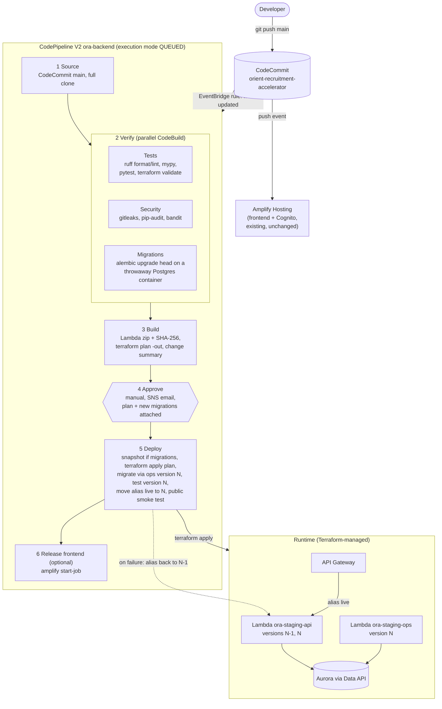

# Backend CI/CD pipeline (CodeCommit -> CodePipeline -> CodeBuild)

Status: **design, not built yet.** Account `Orient_Internal_AI` (917511768830), region `ap-south-1`.
Replaces the manual `scripts/deploy-api.ps1` run and the retired GitHub Actions workflow
(`cicd-pipeline.md`). GitHub stays a backup remote only.

## 1. Goals

- Every push to CodeCommit `main` tests, builds and deploys the backend without a developer laptop or SSO login.
- A human approves each production release after seeing the Terraform plan and the database migrations.
- A failed release never leaves the API broken: the previous Lambda version keeps serving, and rollback takes seconds.
- Meets the DevSecOps gates in `.kiro/steering/devsecops.md`: format, lint, type check, tests, dependency scan, secret scan, SAST, migration validation, backup before migration, rollback plan, human approval.

## 2. Architecture



## 3. Stages in detail

### Stage 1: Source
- CodeCommit source action on `main`, output format **full clone** (`CODEBUILD_CLONE_REF`) so later steps can diff against the last deployed commit.
- Trigger: EventBridge rule on `referenceUpdated` for `refs/heads/main` (no polling).
- Execution mode **QUEUED**: releases run one after another, never in parallel. The Terraform S3 lockfile is a second guard.

### Stage 2: Verify (three CodeBuild actions in parallel, no AWS deploy rights)
| Action | Runs | Fails the release when |
|---|---|---|
| Tests | `ruff format --check`, `ruff check`, `mypy`, `pytest` (backend, 414+ tests), `terraform fmt -check` + `validate` | any check fails |
| Security | `gitleaks` with the repo's `.gitleaks.toml`, `pip-audit` on the pinned backend dependencies, `bandit` on `backend/app` | a secret is found, or a known-vulnerable dependency / high-severity finding |
| Migrations | starts `postgres:16` in the build container, runs `alembic upgrade head` from an empty database and lists the revisions added since the last release | a migration fails, or there are multiple Alembic heads |

### Stage 3: Build
- Builds the Lambda package on Linux: pinned dependencies, `backend/app`, Alembic migrations, the Data API driver. Same content as `scripts/build-lambda.ps1`.
- Records the SHA-256 of the zip.
- `terraform plan -out=tfplan` with the remote state. The plan file and a plain-text summary go into the pipeline artifact.
- Writes `release-notes.txt`: commit range, changed backend files, new migration files, plan summary (resources to add/change/destroy).
- **Path check:** if the commit range changes nothing under `backend/`, `Orient_Internal_AI_Deployment/terraform/` or `interview-agent/`, the build marks the release as "no backend change" and stages 4 and 5 exit immediately. Frontend-only changes are already handled by Amplify.

### Stage 4: Approve
- Manual approval action. An SNS email goes to the release approvers with a link to `release-notes.txt` and the plan.
- The approver checks: resources to destroy (should normally be 0), new migrations (must be backward compatible, see section 5), and the change summary.
- Rejecting stops the release; nothing has changed in AWS.

### Stage 5: Deploy (CodeBuild with the deploy role)
1. **Backup** (only when the release contains new migrations): manual Aurora cluster snapshot `ora-pre-<commit>`, waits until available. This is the "backup confirmation" gate.
2. **Infrastructure + code:** `terraform apply tfplan` applies exactly the approved plan. If the state changed since the plan was made, apply refuses (stale plan) and the release fails safely; re-run the pipeline. Lambda functions are published as a new **version N**. The `live` alias still points to N-1, so users keep getting the old code.
3. **Migrate:** invokes `ora-staging-ops` **version N** with `{"action":"migrate"}`. Retries while Aurora resumes from auto-pause.
4. **Pre-release test:** invokes `ora-staging-api` **version N** directly with a synthetic `GET /health` event. Expects 200.
5. **Switch:** points alias `live` to version N. API Gateway calls the alias, so the switch is immediate and atomic.
6. **Smoke test:** `GET <api>/health` and `GET <api>/api/v1/auth/me` (expects 401, which proves routing, the app and the auth layer). Retries for up to 2 minutes.
7. **Automatic rollback:** if step 6 fails, the alias goes back to N-1 and the stage fails. The schema stays migrated, which is safe because migrations are backward compatible.
8. **Interview agent** (only when `interview-agent/` changed): installs the pinned AgentCore CLI and runs `scripts/deploy-agent.ps1` equivalent (`agentcore deploy --target default`), webhook secret read from Terraform state.

### Stage 6: Release frontend (optional, recommended)
Both Amplify and this pipeline currently start on the same push, so a frontend change can go live before the API it needs. Two options:
- **A (simple, current):** keep Amplify auto-build. Rule: API changes must be additive, so the old and new frontend both work against the new API.
- **B (ordered):** turn off Amplify auto-build; this stage calls `aws amplify start-job --job-type RELEASE` after the backend is live. One pipeline releases everything in the right order.

## 4. Rollback

| What | How | Time |
|---|---|---|
| API code | `aws lambda update-alias --function-name ora-staging-api --name live --function-version <N-1>` (or re-run the pipeline on the previous commit). Published versions keep their own copy of the code, so old builds are always available. | seconds |
| Infrastructure | `git revert` the change and push; the pipeline plans and applies the revert. State is versioned in S3. | one pipeline run |
| Frontend | Amplify console: redeploy an earlier build, or `git revert`. | minutes |
| Database schema | No automatic down-migrations. Fix forward with a new migration, or restore the `ora-pre-<commit>` snapshot to a new cluster (slow, restores data to that moment; last resort). | fix forward: one release |
| Interview agent | Re-run the pipeline on the previous commit (`agentcore deploy`). | minutes |

## 5. Database migration rules (expand / contract)

Code rolls back in seconds; the schema does not. Every migration must keep the **previous** app version working:
- Allowed in one release: add tables, add nullable columns, add indexes, add columns with defaults.
- Two releases needed: rename or remove a column (release 1 adds the new column and writes both; release 2 removes the old one after the old code is gone).
- Never in the same release: drop, rename, or change the type of something the running code uses.
- The approver checks new migration files against these rules in stage 4.

## 6. Security of the pipeline

| Control | How |
|---|---|
| No long-lived keys | CodePipeline and CodeBuild use IAM service roles. |
| Separate roles | Verify and build roles: read source, write logs and artifacts, read Terraform state for plan. **Only the deploy role** can change AWS resources. |
| Least privilege | Deploy role scoped to `ora-staging-*` resources where IAM allows; roles it creates get a permissions boundary, so Terraform cannot create a role more powerful than intended. Not `AdministratorAccess`. |
| Approved plan only | Apply uses the saved plan file from stage 3; nothing else can be applied. |
| Secrets | Never in buildspecs or logs. Terraform outputs that are secrets stay `sensitive`; build logs mask them. |
| Artifacts | Private, encrypted (KMS) artifact bucket; 30-day expiry. |
| Audit | Every execution, approval (who, when, comment) and CloudTrail event is recorded. |
| Isolation | The pipeline's own resources live in a separate Terraform root (`terraform-pipeline/`), applied manually, so the pipeline cannot change or delete itself. |

## 7. Terraform changes needed in the app stack

- `publish = true` on both Lambdas, an `aws_lambda_alias.live` for `api` (and `ops`), and the API Gateway integration and invoke permission pointing to the alias.
- `lifecycle { ignore_changes = [function_version] }` on the alias, because the pipeline (not Terraform) moves it after testing.
- Keep the last few Lambda versions; remove older ones in the deploy step (Lambda has a 75 GB code-storage quota per Region).

## 8. Files to add

```
Orient_Internal_AI_Deployment/
  terraform-pipeline/        # pipeline infra, separate state key, applied once by hand
    main.tf                  #   CodePipeline V2, CodeBuild projects, EventBridge rule,
                             #   SNS approval topic, artifact bucket (KMS), IAM roles
  buildspec/
    verify-tests.yml
    verify-security.yml
    verify-migrations.yml
    build.yml
    deploy.yml
  scripts/
    release.sh               # deploy-stage logic: snapshot, apply, migrate, test N, switch, smoke, rollback
```

All new resources carry the six cost tags (Project, Application, Environment, Owner, CostCenter, ManagedBy).

## 9. Estimated cost (unverified list prices, ap-south-1)

| Item | Per release | 30 releases/month |
|---|---|---|
| CodeBuild (small/medium Linux, about 12-15 build minutes in total) | about $0.10-0.20 | $3-6 |
| CodePipeline V2 (billed per action-execution minute) | a few cents | about $1-2 |
| Artifact bucket, SNS, logs, KMS key | | about $1-2 |
| Aurora snapshots before migrations (incremental) | | well under $1 |
| **Total** | | **about $5-10 a month** |

## 10. Rollout plan

1. Terraform app-stack change for versions + alias (section 7). One manual apply; no downtime.
2. Create `terraform-pipeline/` and the buildspecs; apply once by hand.
3. Run the pipeline on the current commit and approve. Expected: no resource changes, a new Lambda version, alias moves, smoke test passes.
4. Test a rollback on purpose (move the alias back and forth).
5. Decide option A or B for the frontend (section 3, stage 6).
6. Retire `scripts/deploy-api.ps1` for normal releases; keep it for emergencies.

## Open decisions
- Approver email address(es) for the SNS approval notice.
- Frontend ordering: option A (Amplify auto-build, additive API changes) or option B (pipeline releases the frontend).
- Whether to add a separate staging environment later (a second copy of the stack, with releases promoted from staging to production).
