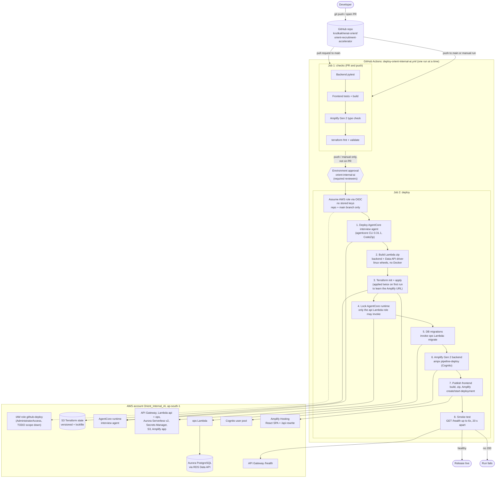

# CI/CD pipeline (Orient_Internal_AI)

> **Superseded.** The GitHub Actions workflow described here was removed: CodeCommit is now the
> deployment source and GitHub is a backup only. See `backend-cicd-pipeline.md` for the current design.

Source: `.github/workflows/deploy-orient-internal-ai.yml`. One GitHub Actions pipeline deploys the AgentCore agent, infrastructure, backend and frontend. Account `Orient_Internal_AI`, region `ap-south-1`.

Status: documented from the workflow and scripts. The pipeline has not been run, and the architecture doc says nothing is deployed yet.

## How it works

- **Trigger:** a pull request to `main` runs the `checks` job only. A push to `main`, or a manual run, runs `checks` and then `deploy`. Only one run executes at a time, and a running deploy is never cancelled.
- **Approval gate:** `deploy` runs in the GitHub environment `orient-internal-ai`. Add required reviewers there to get a human release approval.
- **AWS access:** GitHub issues a short-lived OIDC token. AWS lets the job assume the `github-deploy` role only when the token subject matches `repo:<owner/repo>:ref:refs/heads/main`. No AWS keys are stored in GitHub.

## Job 1: checks

1. Backend `pytest`.
2. Frontend tests and build.
3. Type check of the Amplify Gen 2 (Cognito) code.
4. `terraform fmt -check`, `init -backend=false` and `validate`.

## Job 2: deploy

1. **AgentCore agent:** installs the pinned AgentCore CLI and runs `scripts/deploy-agent.ps1`, which copies the agent project, retargets it to this account, tags it and runs `agentcore deploy`.
2. **Lambda package:** installs backend dependencies as Linux wheels (no Docker), adds the Aurora Data API driver, the app code and the Alembic migrations.
3. **Terraform:** state is stored in `ora-tfstate-<account>-ap-south-1` with lockfile locking. It creates API Gateway, the `api` and `ops` Lambdas, Aurora Serverless v2, Secrets Manager, S3, the Amplify app and the OIDC role. The first run applies twice, because the Amplify URL is only known after the first apply and is then fed back as `app_base_url`.
4. **Lock AgentCore runtime:** a resource policy allows only the `api` Lambda role to invoke the interview agent and denies all other principals.
5. **Migrations:** invokes the `ops` Lambda with `{"action":"migrate"}`. The step fails if the response contains an error. Aurora may need about 30 seconds to resume from auto-pause.
6. **Amplify Gen 2 backend:** `ampx pipeline-deploy` creates the Cognito user pool for staff.
7. **Frontend:** builds the SPA, zips it, and publishes it with `aws amplify create-deployment` and `start-deployment`.
8. **Smoke test:** calls `API_URL/health` up to 6 times, 20 seconds apart. Any non-200 result on the last try fails the run.

## Known gaps

- The deploy role has `AdministratorAccess` (TODO: scope down).
- Untested: `ampx pipeline-deploy` outside the Amplify Console, `agentcore status --json` ARN parsing, and the AgentCore resource-policy command.
- Data API compatibility with the app's SQLAlchemy models and Alembic migrations is not verified. Data API fails on responses over 1 MB and statements over about 45 seconds.
- `architecture-v2.md` says `terraform/` still implements v1 (VPC plus fck-nat), while the README describes v2. Check `terraform/main.tf` to confirm which one it creates.
- The agent-to-HR-API result webhook is not wired.
- Cognito is provisioned but the app does not use it yet.

## Related files

- `docs/architecture-v2.md`: architecture and cost estimate.
- `README.md`: first-deploy steps from a developer machine.
- `terraform/cicd.tf`: OIDC provider and deploy role.
- `scripts/deploy.ps1`: the same steps run locally.
