# Business Requirements Document (BRD)

## Orient Recruitment Accelerator — HR Recruitment & Onboarding Automation

| | |
|---|---|
| **Document ID** | ORA-BRD-001 |
| **Version** | 0.1 (Draft for review) |
| **Date** | 2026-11-07 |
| **Prepared for** | HR leadership, Hiring Managers, IT / Engineering, Compliance |
| **Status** | Draft — pending stakeholder review and sign-off (section 19) |
| **Related** | [requirements.md](../.kiro/specs/recruitment-platform/requirements.md) (MVP), [requirements-long-term.md](../.kiro/specs/recruitment-platform/requirements-long-term.md) (technical requirements, Req 17–35), [open-decisions.md](open-decisions.md), [permission-matrix.md](permission-matrix.md), [PROJECT_DOCUMENTATION.md](PROJECT_DOCUMENTATION.md) |

**How to read this document.** Sections 1–7 explain *why* and *what for*. Section 8 lists
business requirements. Sections 9 and 10 are the **functional** and **non-functional**
requirements. Sections 11–19 cover data, integrations, governance, risks, plan and sign-off.
Appendix A holds the original stakeholder use-case list; Appendix B shows the current
implementation status. Target values marked **(proposed)** are starting points that need
confirmation by the business owner; they are not commitments.

---

## 1. Executive summary

HR currently handles recruitment and onboarding through many manual steps: reading CVs,
scheduling interviews, sending reminders, chasing documents and answering repetitive
questions. These steps consume recruiter time, depend on individual follow-up, and leave
little visible evidence of where a candidate or joiner is stuck.

Orient Recruitment Accelerator already covers the core of recruitment: campaigns, versioned
job descriptions and rules, safe resume intake, explainable deterministic screening, human
review, interviews, decisions, waitlist, talent pool, privacy and audit.

This BRD defines the **long-term plan** to extend the platform across the whole journey —
**sourcing → screening → interview → offer → documents → joining → induction** — using
automation and AI **where they remove manual work, shorten turnaround, reduce follow-ups and
improve tracking**. Twenty use cases were identified by HR and are traced through this
document (Appendix A).

AI remains **assistive**. It may extract, summarise, flag and recommend; it never makes or
triggers a hiring, offer, rejection or clearance decision, and every AI feature has a
deterministic fallback.

## 2. Business context and problem statement

| # | Problem today | Business impact |
|---|---|---|
| P1 | Recruiters read and rank large volumes of CVs by hand. | Slow shortlisting; inconsistent judgement. |
| P2 | CV data lives in documents, not in structured records. | Re-keying; weak search and reporting. |
| P3 | Interview scheduling and reminders are manual. | Coordination effort; no-shows; lost slots. |
| P4 | Confirmation from the candidate does not automatically reach the interviewer. | Missed or duplicated communication. |
| P5 | The 48-hour CV-shortlisting target is not systematically tracked. | Silent SLA misses; no early warning. |
| P6 | Interviewer feedback is unstructured and scattered. | Slow, hard-to-compare decisions. |
| P7 | Offer, document and joining follow-ups depend on individual memory. | Delays; candidate drop-off before joining. |
| P8 | Policies, SOPs and joining details are shared ad hoc. | Inconsistent new-joiner experience. |
| P9 | Employees ask HR the same policy and holiday questions repeatedly. | HR time spent on routine answers. |
| P10 | Recruitment, onboarding and HRMS (ZingHR) data are disconnected. | Duplicate entry; record mismatch. |

## 3. Business objectives and success measures

Baselines have not yet been measured. The first deliverable of each phase is to capture the
baseline; targets are **(proposed)**.

| Obj. | Objective | Measure | Baseline | Target (proposed) |
|---|---|---|---|---|
| O1 | Shorten time to shortlist | Share of applications with a shortlist outcome within 48 h of being ready for review | TBD | ≥ 90% |
| O2 | Reduce manual follow-up effort | Recruiter/HR hours per hire spent on reminders and chasing | TBD | −50% |
| O3 | Reduce interview no-shows and reschedule effort | No-show rate; reschedules handled without recruiter effort | TBD | −30% no-shows |
| O4 | Improve process tracking | Share of candidates/joiners whose current status and next owner are visible in the system | Partial | 100% |
| O5 | Speed up post-selection onboarding | Share of required documents received before joining date | TBD | ≥ 95% |
| O6 | Improve data quality at joining | Documents with unresolved inconsistencies at joining | TBD | 0 unresolved |
| O7 | Reduce routine HR queries | Policy/holiday questions answered without HR involvement | TBD | ≥ 60% |
| O8 | Keep decisions human and explainable | AI-influenced decisions made without human review | 0 | 0 (hard rule) |

## 4. Scope

### 4.1 In scope (long-term)

Recruitment: matching and shortlisting, extraction, preliminary screening, interview
scheduling, reminders, candidate confirmation and interviewer notification, feedback
summarisation, SLA monitoring and escalation, sourcing integration (feasibility, then build
if approved), offer and post-selection follow-ups.

Onboarding: document checklist and collection, submission reminders, AI-assisted document
verification, pre-joining communication, induction (including an AI-avatar evaluation),
policy and SOP distribution, HR text assistant, ZingHR integration (feasibility, then build if
approved), welcome and announcement communications.

### 4.2 Out of scope

- Any automated hiring, offer, rejection or onboarding-clearance **decision**.
- Video, voice, emotion, personality, face or medical inference (product rule).
- Scraping of job boards or social media.
- Payroll, attendance, leave, performance management and other HRMS functions (these remain
  in ZingHR or the system of record).
- Background checks and authoritative identity-document verification (consistency checks
  only).
- Multi-tenant SaaS and Kubernetes (deferred; separate ADR needed).
- Legal compliance certification. The platform provides technical controls that support
  the organisation's own compliance work.

### 4.3 Phasing summary

| Phase | Theme | Use cases |
|---|---|---|
| **0** | Feasibility spikes (time-boxed, each ends in an ADR) | Sourcing (Naukri/NOCR), ZingHR, avatar induction, WhatsApp provider |
| **A** | Notification and SLA foundation | UC-R05, UC-R06, UC-R08 |
| **B** | Scheduling, feedback, offer | UC-R04, UC-R07, UC-R10 |
| **C** | Onboarding core | UC-O01, UC-O02, UC-O04, UC-O06, UC-O09 (and document collection of UC-R11) |
| **D** | AI-assisted verification and assistant | UC-O03 (and verification of UC-R11), UC-O07 |
| **E** | External integrations and induction | UC-R09, UC-O08, UC-O05 (subject to Phase 0 outcome) |
| Existing | Enhance what exists | UC-R01, UC-R02, UC-R03 |

## 5. Stakeholders and user roles

| Stakeholder / role | Interest | Main interactions |
|---|---|---|
| HR Head / HR Owner | Outcomes, SLA, governance, cost | Dashboards, escalations, approvals, policies |
| Recruiter | Faster shortlisting, less chasing | Campaigns, review queue, scheduling, notifications |
| Recruiter Admin (approver) | Approvals and sign-off | JD/rules/threshold/offer/interview approvals |
| Hiring Manager / Interview Panel | Better-prepared candidates, quick feedback | Slots, assessments, summaries |
| Onboarding / HR Operations | Complete, verified joining files | Checklists, document review, ZingHR push |
| New Joiner / Employee | Clear, simple joining and induction | Document upload, policy library, assistant, induction |
| Candidate | Clear communication, easy scheduling | Apply, confirm interview, preliminary screening, offer |
| Management Viewer | Aggregated insight | Dashboards (no PII) |
| Compliance / Audit Viewer | Evidence and traceability | Audit log (read-only) |
| System Administrator | Operate and secure the platform | Users, configuration, integrations (no automatic candidate-content access) |
| IT / Security | Safe integrations, secrets, data residency | Review, approvals |
| External: ZingHR, Naukri/NOCR, Microsoft 365, WhatsApp provider | Interfaces | Per section 12 |

## 6. Process view

### 6.1 End-to-end lifecycle (target state)

```mermaid
flowchart LR
  S[Sourcing / Apply] --> X[Extract & verify]
  X --> M[Match & shortlist]
  M --> R[Human review]
  R --> P[Preliminary screening]
  P --> I[Schedule interview]
  I --> C[Confirm & remind]
  C --> F[Interview + feedback summary]
  F --> D[Decision]
  D --> O[Offer & follow-up]
  O --> B[Onboarding case]
  B --> DC[Document collection & verification]
  DC --> J[Pre-joining info]
  J --> W[Welcome & announcement]
  W --> IN[Induction, policies, SOPs]
  IN --> H[HR assistant]
  B -. employee record .-> Z[(ZingHR)]
  M -. SLA clock 48h .-> SLA{{SLA monitor}}
  SLA -. reminder / escalation .-> R
```

### 6.2 Human decision points (never automated)

Shortlist confirmation · interview invitation approval · hiring decision · offer approval ·
acceptance of each verification flag · ZingHR push confirmation · publication of each
policy and communication template.

## 7. Current state versus target state

| Area | Current state | Target state |
|---|---|---|
| Screening | Deterministic, explainable, human review | Same; richer criteria and cross-campaign suggestions |
| Notifications | Specified but not delivered | Email + WhatsApp with templates, log and consent |
| Scheduling | Manual slots and invitations | Availability-aware proposals after approval |
| SLA | Not tracked | 48-hour clock, reminders, escalation, dashboard |
| Feedback | Structured assessment only | Aggregated advisory summary per candidate |
| Offer | Decision recorded only | Offer record and follow-up reminders |
| Onboarding | Induction video only | Case, checklist, verification, pre-joining, welcome |
| Policies / SOPs | Not in the product | Versioned library with acknowledgement |
| HR questions | Recruiter how-to assistant | Employee HR assistant over approved sources |
| HRMS | None | ZingHR adapter (if feasible), confirmed pushes |

## 8. Business requirements

| ID | Business requirement | Use cases | Objective | Priority |
|---|---|---|---|---|
| BR-01 | HR shall be able to identify relevant candidates quickly against a JD using skills, experience, location and (where permitted) salary alignment, with the reasons visible. | UC-R01 | O1 | Must |
| BR-02 | Candidate information from CVs shall be held in structured, verifiable form. | UC-R02 | O4 | Must |
| BR-03 | A role-specific initial screening shall be available before the technical round, as input to a human decision. | UC-R03 | O1, O8 | Should |
| BR-04 | Interview scheduling shall use interviewer and candidate availability with minimal manual coordination. | UC-R04 | O2, O3 | Should |
| BR-05 | Candidates shall receive confirmation requests and reminders by WhatsApp and email. | UC-R05 | O2, O3 | Must |
| BR-06 | A candidate's confirmation shall automatically notify the interviewer. | UC-R06 | O2 | Must |
| BR-07 | Interviewer feedback shall be consolidated into a structured, summarised record. | UC-R07 | O4 | Should |
| BR-08 | The 48-hour shortlisting SLA shall be tracked, with automatic reminders and escalations. | UC-R08 | O1, O4 | Must |
| BR-09 | The feasibility of sourcing from Naukri/NOCR and similar platforms shall be established before any build. | UC-R09 | O1 | Could |
| BR-10 | Offer-related reminders and communication shall be automated, with human approval of the offer itself. | UC-R10 | O2, O5 | Should |
| BR-11 | Required joining documents shall be requested automatically after selection and chased until received. | UC-R11, UC-O01, UC-O02 | O2, O5 | Must |
| BR-12 | Submitted documents shall be checked for missing or inconsistent information and flagged for HR. | UC-R11, UC-O03 | O6 | Should |
| BR-13 | Joiners shall receive reporting manager, department, KPI and joining information before day one. | UC-O04 | O5 | Must |
| BR-14 | An AI-avatar induction shall be evaluated for company introduction, policy and stakeholder content. | UC-O05 | O4 | Could |
| BR-15 | Relevant HR policies and department SOPs shall be provided to each new joiner. | UC-O06 | O4 | Must |
| BR-16 | Employees shall have a text assistant for HR policy, holiday and common queries. | UC-O07 | O7 | Should |
| BR-17 | Integration with ZingHR shall be assessed for employee documentation and record / code creation. | UC-O08 | O4, O6 | Could |
| BR-18 | A welcome email shall go to the joiner and an announcement to relevant employees on the joining date. | UC-O09 | O5 | Must |
| BR-19 | All automation shall be auditable, privacy-respecting and operable without AI. | All | O8 | Must |
| BR-20 | Delivery shall be phased so that each phase gives usable value and can be switched off independently. | All | All | Must |

Priority uses MoSCoW. **Must** = needed for the phase to deliver its business value.

## 9. Functional requirements

Each FR traces to a business requirement and to the technical requirement in
[requirements-long-term.md](../.kiro/specs/recruitment-platform/requirements-long-term.md)
(column **Req**). **Phase** uses section 4.3. All FRs inherit the guardrails in section 13.

### 9.1 Matching and shortlisting (Existing) — BR-01

| ID | Requirement | Req | Priority |
|---|---|---|---|
| FR-MAT-01 | Match candidates on skills, experience, location / work mode, notice period and education using approved rule versions. | 17.1 | Must |
| FR-MAT-02 | Show a ranked shortlist with per-criterion evidence and confidence. | 17.1 | Must |
| FR-MAT-03 | Where compensation is enabled, show budget alignment as advisory information to authorised users only; never as an automatic exclusion. | 17.1 | Could |
| FR-MAT-04 | Route missing, conflicting or low-confidence evidence to human review. | 17.1 | Must |
| FR-MAT-05 | Suggest "potential match for another campaign" with recruiter verification before contact. | 17.2 | Could |

### 9.2 Resume extraction (Existing) — BR-02

| ID | Requirement | Req | Priority |
|---|---|---|---|
| FR-EXT-01 | Maintain a structured profile (identity, skills, employment history, experience, education, certifications, location) with source, confidence and verification status. | 18.1 | Must |
| FR-EXT-02 | Keep verified and unverified values separate and flag low-confidence fields. | 18.1 | Must |
| FR-EXT-03 | Export the structured profile with spreadsheet-formula neutralisation. | 18.1 | Should |

### 9.3 Preliminary screening (Existing) — BR-03

| ID | Requirement | Req | Priority |
|---|---|---|---|
| FR-PSC-01 | Generate role-specific questions from the approved JD for recruiter approval before issuing. | 19.1 | Should |
| FR-PSC-02 | Issue a single-use expiring candidate link and record consent before start. | 19.1 | Must |
| FR-PSC-03 | Produce a transcript and evidence-linked summary of answer **content** only; no voice, tone, face or emotion analysis. | 19.1 | Must |
| FR-PSC-04 | Treat results as advisory; the recruiter records the outcome. | 19.1 | Must |
| FR-PSC-05 | Offer a non-AI alternative (text or recruiter call) and a scripted fallback when AI is disabled. | 19.1 | Should |

### 9.4 Interview scheduling — BR-04 (Phase B)

| ID | Requirement | Req | Priority |
|---|---|---|---|
| FR-SCH-01 | Store interviewer availability and read free/busy from a connected calendar behind a provider interface. | 20.1 | Should |
| FR-SCH-02 | Propose slots only for approved invitations, honouring panel, mode, location and capacity. | 20.2 | Should |
| FR-SCH-03 | Create the calendar event on confirmation and update capacity atomically. | 20.2 | Should |
| FR-SCH-04 | Handle cancellations and reschedules with history and notifications. | 20.2 | Should |
| FR-SCH-05 | Tell the recruiter when no slot fits; never overbook. | 20.2 | Must |

### 9.5 Notifications and reminders — BR-05 (Phase A)

| ID | Requirement | Req | Priority |
|---|---|---|---|
| FR-NTF-01 | Provide email and WhatsApp channel adapters behind one provider-neutral interface. | 21.1 | Must |
| FR-NTF-02 | Show per-message state (queued, sent, delivered, failed, suppressed, unconfigured); never report "sent" without a provider. | 21.1 | Must |
| FR-NTF-03 | Offer a manual-send fallback when a channel is unconfigured and record it as manual. | 21.1 | Should |
| FR-NTF-04 | Send interview confirmation requests and reminders at configurable offsets; cancel on reschedule or check-in. | 21.2 | Must |
| FR-NTF-05 | Use versioned, HR-approved templates; keep language extensible. | 21.2 | Must |
| FR-NTF-06 | Enforce WhatsApp consent, approved templates, opt-out, rate limits, retries and dead-letter visibility. | 21.3 | Must |
| FR-NTF-07 | Never include internal scores or recruiter notes in candidate messages. | 21.3 | Must |
| FR-NTF-08 | Keep a per-application delivery log visible to authorised HR users. | 21.1 | Must |

### 9.6 Candidate confirmation and interviewer notification — BR-06 (Phase A)

| ID | Requirement | Req | Priority |
|---|---|---|---|
| FR-CNF-01 | Let the candidate confirm, decline or request reschedule via a signed, single-purpose, expiring link (and a channel reply where supported). | 22.1 | Must |
| FR-CNF-02 | On confirmation, update the slot state and notify the interviewer automatically. | 22.1 | Must |
| FR-CNF-03 | On decline or reschedule request, notify the recruiter and start the replacement flow. | 22.1 | Must |
| FR-CNF-04 | If there is no reply by the deadline, send a final reminder and flag the item for the recruiter without auto-cancelling. | 22.1 | Should |

### 9.7 Feedback summarisation — BR-07 (Phase B)

| ID | Requirement | Req | Priority |
|---|---|---|---|
| FR-FBK-01 | Aggregate each interviewer's scores, notes and recommendation per candidate, keeping originals unchanged. | 23.1 | Must |
| FR-FBK-02 | Produce a summary from interviewer-entered text only, showing agreement, disagreement and linked evidence. | 23.1 | Should |
| FR-FBK-03 | Label the summary advisory; it never alters a recommendation or decision. | 23.1 | Must |
| FR-FBK-04 | Provide a deterministic aggregation when AI is disabled and record model / template versions when AI is used. | 23.1 | Must |
| FR-FBK-05 | Restrict panel members to summaries of candidates they interviewed. | 23.1 | Must |

### 9.8 SLA monitoring and follow-up — BR-08 (Phase A)

| ID | Requirement | Req | Priority |
|---|---|---|---|
| FR-SLA-01 | Configure SLA policies per campaign/template; default shortlist decision within 48 hours of "ready for review". | 24.1 | Must |
| FR-SLA-02 | Define clock start, pause (for example awaiting candidate information) and stop; support business hours and holidays. | 24.1 | Must |
| FR-SLA-03 | Send an at-risk reminder (default at 75% of the window) to the responsible recruiter. | 24.1 | Must |
| FR-SLA-04 | Escalate on breach along a configurable chain and record each escalation. | 24.1 | Must |
| FR-SLA-05 | Provide an SLA view (at-risk, breached, trend) per campaign; do not rank individual recruiters. | 24.1 | Must |
| FR-SLA-06 | Allow an extension for one application only with a reason; audit it. | 24.1 | Should |

### 9.9 Sourcing integration — BR-09 (Phase 0 then E)

| ID | Requirement | Req | Priority |
|---|---|---|---|
| FR-SRC-01 | Produce a feasibility assessment and ADR for Naukri, NOCR and similar platforms. | 25.1 | Must (Phase 0) |
| FR-SRC-02 | If approved, import only through official, permitted APIs or exports via a `SourcingProvider` interface. | 25.2 | Could |
| FR-SRC-03 | Apply duplicate detection, the standard document pipeline, source attribution and lawful-basis recording to imports. | 25.2 | Could |
| FR-SRC-04 | Do not add imported candidates to the talent pool without separate explicit consent. | 25.2 | Must (if built) |

### 9.10 Offer and post-selection follow-up — BR-10 (Phase B)

| ID | Requirement | Req | Priority |
|---|---|---|---|
| FR-OFR-01 | Create an offer record (drafted, approved, issued, accepted, declined, expired, withdrawn) from an approved "select" decision. | 26.1 | Should |
| FR-OFR-02 | Require authorised approval to issue an offer; never create or change an offer automatically. | 26.1 | Must |
| FR-OFR-03 | Send follow-up reminders while an offer is unanswered and notify on expiry. | 26.1 | Should |
| FR-OFR-04 | On acceptance, create the onboarding case; on decline or expiry, notify and offer a waitlist path. | 26.1 | Should |

### 9.11 Document collection and reminders — BR-11 (Phase C)

| ID | Requirement | Req | Priority |
|---|---|---|---|
| FR-DOC-01 | Create an onboarding case and send the checklist when a candidate is selected or accepts, per campaign setting. | 27.1 | Must |
| FR-DOC-02 | Maintain checklists by role, employment type and location, with per-item status (requested, submitted, in review, accepted, correction requested, waived). | 27.1 | Must |
| FR-DOC-03 | Collect no onboarding data before selection / acceptance; keep it inaccessible to screening. | 27.1 | Must |
| FR-DOC-04 | Accept uploads via signed expiring link or authenticated portal through the quarantine and scan pipeline. | 27.2 | Must |
| FR-DOC-05 | Store documents encrypted with signed short-lived access links only; mask identity numbers by default with audited reveal. | 27.2 | Must |
| FR-DOC-06 | Send reminders (email, and WhatsApp with consent) for outstanding items until accepted or waived; escalate to HR at the maximum or near joining. | 27.3 | Must |
| FR-DOC-07 | Reminders list outstanding items only, never document contents. | 27.3 | Must |

### 9.12 AI-assisted document verification — BR-12 (Phase D)

| ID | Requirement | Req | Priority |
|---|---|---|---|
| FR-VER-01 | Extract relevant fields from each document with confidence and source location. | 28.1 | Should |
| FR-VER-02 | Compare against verified application data and other documents; flag missing, inconsistent, expired, unreadable and low-confidence items. | 28.1 | Should |
| FR-VER-03 | Show flags with side-by-side evidence; a flag never changes status or withdraws an offer automatically. | 28.1 | Must |
| FR-VER-04 | HR accepts, requests correction, waives or escalates each flag with a reason; audited. | 28.1 | Must |
| FR-VER-05 | Make no claim of authenticity or forgery detection; consistency checks only. | 28.1 | Must |
| FR-VER-06 | Provide a deterministic OCR / rule-based mode when AI is disabled; minimise and redact data if an external model is used. | 28.1 | Must |

### 9.13 Pre-joining communication — BR-13 (Phase C)

| ID | Requirement | Req | Priority |
|---|---|---|---|
| FR-PJN-01 | Hold joining date, reporting manager, department, location and role expectations (for example KPI summary) per case. | 29.1 | Must |
| FR-PJN-02 | Send pre-joining messages at configurable offsets (for example T-7, T-2, T-1). | 29.1 | Must |
| FR-PJN-03 | Require HR approval of template and case-specific text before first send. | 29.1 | Must |
| FR-PJN-04 | Reschedule or correct messages if joining details change; suppress on withdrawal or no-show. | 29.1 | Should |

### 9.14 Induction — BR-14 (Phase 0 then E)

| ID | Requirement | Req | Priority |
|---|---|---|---|
| FR-IND-01 | Evaluate avatar / synthetic-video vendors (cost, languages, approval workflow, residency, accessibility, risk) and record an ADR. | 30.1 | Could (Phase 0) |
| FR-IND-02 | If approved, use avatars for content delivery only; no analysis of face, voice or reactions. | 30.1 | Must (if built) |
| FR-IND-03 | HR authors and approves induction content before generation; versioned. | 30.1 | Must (if built) |
| FR-IND-04 | Disclose AI-generated presenters; provide captions and transcript; keep the recorded video as fallback. | 30.1 | Must (if built) |
| FR-IND-05 | Record per-employee completion and continue issuing the certificate. | 30.1 | Should |
| FR-IND-06 | HR view of induction progress across employees. | 30.1 | Should |

### 9.15 Policy and SOP distribution — BR-15 (Phase C)

| ID | Requirement | Req | Priority |
|---|---|---|---|
| FR-POL-01 | Maintain a versioned library (owner, effective date, audience by department / role / location, status). | 31.1 | Must |
| FR-POL-02 | Auto-assign matching documents to each joiner from the joining date (or earlier if HR chooses). | 31.1 | Must |
| FR-POL-03 | Record acknowledgement per joiner per version and remind on outstanding items. | 31.1 | Must |
| FR-POL-04 | Keep prior versions; never change what was already acknowledged. | 31.1 | Must |
| FR-POL-05 | Distribute and use as assistant sources only approved versions. | 31.1 | Must |

### 9.16 HR text assistant — BR-16 (Phase D)

| ID | Requirement | Req | Priority |
|---|---|---|---|
| FR-BOT-01 | Answer from approved sources only (policy library, holiday calendar, HR-curated FAQ) and cite source and version. | 32.1 | Must |
| FR-BOT-02 | If no approved source answers, say so and offer to route to HR; never guess. | 32.1 | Must |
| FR-BOT-03 | Refuse questions about other people's data and legal / medical / financial advice; personal data only to the authenticated owner, if enabled. | 32.1 | Must |
| FR-BOT-04 | Work in deterministic retrieval mode when AI is disabled; constrain AI phrasing to retrieved text. | 32.1 | Must |
| FR-BOT-05 | Log without unnecessary identifiers; give HR an aggregate "unanswered questions" report. | 32.1 | Should |
| FR-BOT-06 | Provide an accessible interface (keyboard, labels). | 32.1 | Must |

### 9.17 ZingHR integration — BR-17 (Phase 0 then E)

| ID | Requirement | Req | Priority |
|---|---|---|---|
| FR-ZHR-01 | Assess ZingHR APIs (auth, endpoints, limits, sandbox, errors, licensing) and record an ADR; assume no behaviour that is not confirmed. | 33.1 | Must (Phase 0) |
| FR-ZHR-02 | Integrate through an `HrmsProvider` interface. | 33.2 | Could |
| FR-ZHR-03 | Require HR confirmation before any record is sent; idempotent calls; retries with back-off; failures to an HR work queue. | 33.2 | Must (if built) |
| FR-ZHR-04 | Send only the fields needed; store the returned employee identifier on the case. | 33.2 | Must (if built) |
| FR-ZHR-05 | Keep credentials in a secret store; allow the integration to be switched off without breaking onboarding. | 33.2 | Must (if built) |

### 9.18 Welcome communication — BR-18 (Phase C)

| ID | Requirement | Req | Priority |
|---|---|---|---|
| FR-WEL-01 | On the joining date send a welcome email to the joiner from an approved template. | 34.1 | Must |
| FR-WEL-02 | On the joining date send an announcement to HR-configured recipients, after HR approves text and recipients. | 34.1 | Must |
| FR-WEL-03 | Share only information the joiner agreed to share; photo or personal details need explicit consent. | 34.1 | Must |
| FR-WEL-04 | Cancel or reschedule on change of date or withdrawal; log both messages. | 34.1 | Should |

### 9.19 Platform and cross-cutting — BR-19, BR-20

| ID | Requirement | Req | Priority |
|---|---|---|---|
| FR-PLT-01 | Run time-based work through persisted, idempotent scheduled jobs that recover after restart. | 35.1 | Must |
| FR-PLT-02 | Provide an adapter framework for calendar, messaging, sourcing, HRMS and AI providers, with start-up validation, `/ready` health and an explicit "not configured" state. | 35.2 | Must |
| FR-PLT-03 | Add permissions for notification templates, SLA policy, onboarding, document verification, policy library, integrations and offers, with object-level authorisation. | 35.3 | Must |
| FR-PLT-04 | Provide a restricted joiner identity limited to their own onboarding case and the approved policy library. | 35.3 | Must |
| FR-PLT-05 | Extend retention, privacy-request and notice handling to onboarding data, offers, chat logs, notification logs and SLA records. | 35.4 | Must |
| FR-PLT-06 | Add dashboard indicators: SLA at-risk / breached, outstanding onboarding items, upcoming joiners, notification failures, unanswered assistant questions. | 35.5 | Should |
| FR-PLT-07 | Ship every new capability disabled by default and enable it per environment. | 35 (assumption 5) | Must |
| FR-PLT-08 | Emit an audit event for every consequential automated action. | 13 / G9 | Must |

## 10. Non-functional requirements

Targets marked **(proposed)** are starting values to be confirmed with IT, Security and the
business owner before they become acceptance criteria.

### 10.1 Security

| ID | Requirement |
|---|---|
| NFR-SEC-01 | Server-side authorisation (permission **and** object-level scope) on every endpoint; UI hiding is never relied on. |
| NFR-SEC-02 | Candidate- and joiner-facing links are signed or random (≥ 128-bit), single-purpose, expiring, rate-limited and enumeration-safe. |
| NFR-SEC-03 | All documents pass validation, quarantine and malware scanning; no direct public object-storage access; signed short-lived downloads only. |
| NFR-SEC-04 | Provider credentials live in a secret store or environment, never in source, logs or audit events. |
| NFR-SEC-05 | Sensitive onboarding fields (identity numbers, bank-related data) are masked by default and encrypted at rest using the mechanism chosen in open decision 1. |
| NFR-SEC-06 | System Administrators have no automatic access to candidate or joiner document content. |
| NFR-SEC-07 | Defences against SQL injection, XSS, CSRF, SSRF, IDOR, mass assignment, path traversal, zip bombs, CSV injection and prompt injection are retained and tested for every new surface. |
| NFR-SEC-08 | Rate limiting on public and link-based endpoints and on outbound messaging. |
| NFR-SEC-09 | Dependency, secret, SAST and container scanning remain required in CI (steering: `devsecops.md`). |

### 10.2 Privacy and data protection

| ID | Requirement |
|---|---|
| NFR-PRV-01 | Data minimisation: onboarding data is collected only after selection or acceptance and only for onboarding purposes. |
| NFR-PRV-02 | Purpose-specific, versioned privacy notices cover each new purpose before the feature is enabled. |
| NFR-PRV-03 | Separate channel consent is recorded for WhatsApp; opt-out takes effect immediately. |
| NFR-PRV-04 | Retention policies exist for each new record category; destructive actions run only after the owner-notification window. |
| NFR-PRV-05 | Access, correction, deletion and restriction requests cover onboarding data. |
| NFR-PRV-06 | No real candidate or employee data in seed or test data; synthetic data clearly marked. |
| NFR-PRV-07 | Logs and metrics carry no candidate or employee PII. |
| NFR-PRV-08 | Data residency for any external AI or messaging provider is reviewed and recorded before use with real data. |

### 10.3 Responsible AI

| ID | Requirement |
|---|---|
| NFR-AI-01 | AI output is advisory; no decision is made or triggered by it. |
| NFR-AI-02 | Every AI feature has a deterministic fallback and can be disabled by configuration; the core workflow runs with all AI off. |
| NFR-AI-03 | AI output is validated against a strict schema, treated as untrusted, and cannot call tools or networks. |
| NFR-AI-04 | Provider, model version, prompt / template version, confidence and errors are stored for each AI use. |
| NFR-AI-05 | Only the minimum necessary, redacted data is sent to any external model. |
| NFR-AI-06 | No voice, face, emotion, personality, medical or appearance inference. |
| NFR-AI-07 | Missing or conflicting evidence routes to human review; it never disqualifies automatically. |
| NFR-AI-08 | Outcome-oriented language only; no labels such as "unfit" or "bad candidate". |

### 10.4 Performance and capacity (proposed)

| ID | Requirement |
|---|---|
| NFR-PERF-01 | Interactive API calls: p95 ≤ 500 ms for list / read endpoints under normal load (proposed). |
| NFR-PERF-02 | A scheduled message is dispatched to the provider within 60 seconds of its due time (proposed). |
| NFR-PERF-03 | Document upload acknowledged ≤ 5 s; processing and verification flags ready ≤ 2 minutes for a typical document (proposed). |
| NFR-PERF-04 | HR assistant answers in ≤ 3 s in retrieval mode (proposed). |
| NFR-PERF-05 | The design supports the organisation's current hiring volume with headroom of 10× before re-architecture; exact volumes to be provided by HR. |

### 10.5 Availability, reliability and recovery (proposed)

| ID | Requirement |
|---|---|
| NFR-REL-01 | Availability target of 99.5% during business hours (proposed); degradation of an integration SHALL NOT take down the core workflow. |
| NFR-REL-02 | Scheduled jobs are idempotent, resumable and persisted; no duplicate messages after a restart. |
| NFR-REL-03 | Outbound calls use timeouts, back-off retries and circuit-breaking; permanent failures are dead-lettered and visible. |
| NFR-REL-04 | Backup and restore cover new tables and stored documents and are tested (existing procedure extended; RPO ≤ 24 h, RTO ≤ 4 h proposed). |
| NFR-REL-05 | Optimistic concurrency on mutable records (for example slots, offers, onboarding cases) to prevent lost updates and double booking. |

### 10.6 Auditability and traceability

| ID | Requirement |
|---|---|
| NFR-AUD-01 | Append-only, hash-chained audit events for every consequential action, including automated ones (actor recorded as `system` with the triggering rule or job). |
| NFR-AUD-02 | Every notification, verification flag, escalation and integration push is traceable to its trigger and approver. |
| NFR-AUD-03 | SLA results are reproducible from stored timestamps and the stored policy version. |
| NFR-AUD-04 | Template, checklist, SLA-policy and policy-document changes are versioned and immutable once approved. |

### 10.7 Usability and accessibility

| ID | Requirement |
|---|---|
| NFR-USA-01 | WCAG-oriented design: semantic HTML, labels, keyboard navigation, visible focus, accessible error summaries, no colour-only status. |
| NFR-USA-02 | Candidate and joiner pages are mobile-first and work on low-bandwidth connections. |
| NFR-USA-03 | Clear loading, empty, error and "not configured" states on every new page. |
| NFR-USA-04 | Confirmation for consequential actions; unsaved-change warnings; accessible session-expiry handling. |
| NFR-USA-05 | Automated axe checks in component and end-to-end tests; manual assistive-technology review before release. |

### 10.8 Localisation and communication quality

| ID | Requirement |
|---|---|
| NFR-LOC-01 | English at launch; template and UI strings externalised so more languages can be added. |
| NFR-LOC-02 | Dates, times and time zone follow organisation settings and are shown unambiguously in messages. |
| NFR-LOC-03 | Messages are concise, plain-language and respectful; templates reviewed by HR. |

### 10.9 Integration and interoperability

| ID | Requirement |
|---|---|
| NFR-INT-01 | Each external system is accessed via a provider-neutral interface with a "not configured" mode. |
| NFR-INT-02 | Integrations send idempotency keys where the provider supports them and handle duplicate / replayed callbacks safely. |
| NFR-INT-03 | Webhook and callback endpoints verify signatures and are rate-limited. |
| NFR-INT-04 | Vendor limits (rate, message templates, quotas) are configured, not hard-coded. |

### 10.10 Maintainability, testability and operability

| ID | Requirement |
|---|---|
| NFR-MNT-01 | Modular monolith retained (ADR-0001); each new capability is a module with router, service, policy, repository, models and schemas. |
| NFR-MNT-02 | No microservices or Kubernetes without a separate ADR. |
| NFR-MNT-03 | Type-checked (mypy, TypeScript strict), linted, formatted and migrated via Alembic; migrations reviewed and validated in CI. |
| NFR-MNT-04 | Test strategy per steering `testing.md`: domain, state-transition, permission, repository, API, migration, audit, privacy, retention, security, accessibility and end-to-end tests for each phase. |
| NFR-MNT-05 | Structured logs with correlation IDs; metrics for delivery, SLA, jobs and integrations; health and readiness endpoints. |
| NFR-MNT-06 | Feature flags / configuration for each capability; no code change to enable or disable. |
| NFR-MNT-07 | Dependencies pinned. |

### 10.11 Cost and licensing

| ID | Requirement |
|---|---|
| NFR-CST-01 | Provider usage (messaging, AI, avatar, OCR) is metered and visible to HR / IT with configurable limits. |
| NFR-CST-02 | A cost estimate is produced in each Phase 0 spike before a paid provider is chosen. |
| NFR-CST-03 | Licensing posture for OCR, messaging and avatar tooling is reviewed before production use. |

### 10.12 Compliance posture

| ID | Requirement |
|---|---|
| NFR-CMP-01 | The product provides technical controls that support the organisation's compliance work. It is not claimed to be automatically legally compliant or risk-free. |
| NFR-CMP-02 | Applicable Indian data-protection obligations, internal HR policies and contractual terms with providers are reviewed by the organisation's legal / compliance function before real data is processed in each phase. |

## 11. Data requirements

### 11.1 New or extended data entities (conceptual)

| Entity | Purpose | Sensitivity |
|---|---|---|
| NotificationTemplate (versioned) | Approved message content | Low |
| NotificationDelivery | Per-message state, channel, provider response, failure | Medium (contains contact point) |
| ChannelConsent / CommunicationPreference | WhatsApp / email consent and opt-out | Medium |
| SlaPolicy, SlaClock, SlaEscalation | Targets, timers, escalations | Low–Medium |
| InterviewerAvailability, CalendarConnection | Availability and calendar link | Medium |
| InterviewConfirmation | Candidate response to a slot | Medium |
| FeedbackSummary | Advisory summary linked to source entries | High (assessment content) |
| Offer | Offer lifecycle | High |
| OnboardingCase | Joiner, dates, manager, department, status | High |
| DocumentChecklist, ChecklistItem | Required documents per role / location | Low |
| JoinerDocument, DocumentVerificationFlag | Uploaded files and findings | **Very high** (identity data) |
| PolicyDocument, PolicyAssignment, PolicyAcknowledgement | Library, targeting, acknowledgement | Low–Medium |
| AssistantSession / AssistantMessage | Employee questions and answers | Medium |
| IntegrationConnection, IntegrationSyncRecord | Provider config references, push history | Medium (no secrets) |
| AuditEvent (existing) | Tamper-evident trail | Medium |

All tables carry the organisation key, UTC timestamps, `created_at` / `updated_at`,
`version` where concurrency matters, and are append-only where approved (database
standards in steering `database.md`).

### 11.2 Data classification and retention (to be confirmed per record category)

Retention categories to add: onboarding documents, offer records, chat transcripts,
notification logs, SLA records, policy acknowledgements. Retention periods are decisions
for the organisation (see section 18, question 5); the system makes them configurable
and every retention action is logged.

## 12. Integration requirements

| System | Purpose | Direction | Status / dependency |
|---|---|---|---|
| Email service (Microsoft 365 / Outlook assumed) | Candidate, joiner and staff email | Outbound (and inbound replies, optional) | Provider and credentials to be confirmed |
| WhatsApp business provider | Reminders, confirmations, document chasers | Outbound / inbound | Needs approved account and message templates; candidate opt-in |
| Calendar (Microsoft 365 assumed) | Interviewer availability, event creation | Read / write | Permission model to be agreed |
| Naukri / NOCR / other | Candidate sourcing | Inbound | **Feasibility first**; official APIs only |
| ZingHR | Employee record / code, documents, other HR workflows | Outbound (confirmed pushes) | **Feasibility first**; API behaviour not assumed |
| Avatar video vendor | AI-presented induction content | Outbound (content) | **Evaluation first** |
| AI model provider (optional) | Summaries, extraction help, assistant phrasing | Outbound | Disabled by default; data-minimised |
| Object storage (existing) | Documents | Internal | Signed links only |

## 13. Responsible AI, privacy and governance guardrails

These apply to every requirement above (technical form: G1–G10 in
requirements-long-term.md).

1. **No automated decisions.** AI never makes or triggers a hiring, offer, rejection or
   clearance decision.
2. **Deterministic fallback** for every AI-assisted feature; AI can be turned off.
3. **Human in the loop** with reason and audit for every confirmation or override.
4. **Missing evidence is not proof of absence.** It routes to review.
5. **Documents are untrusted input;** existing upload and prompt-injection defences apply.
6. **Minimisation and purpose limitation.** Onboarding data is separate from screening and
   collected only after selection.
7. **No prohibited inference** (voice, face, emotion, personality, medical, appearance).
8. **No internal scores or recruiter notes** in candidate communications.
9. **Auditability** of every consequential action.
10. **Respectful language;** no claim of automatic legal compliance.

Excluded characteristics (age, gender, marital status, medical condition, disability,
religion, caste, race / ethnicity, sexual orientation, photograph, vaccination status,
hobbies, family information) remain excluded from automated screening. Where onboarding
documents contain such data (for example date of birth on an identity document), it is used
only for the onboarding purpose, access is restricted, and it is never visible to or used by
screening.

## 14. Assumptions, constraints and dependencies

### Assumptions
1. The 48-hour SLA applies to CV shortlisting and runs from the application being ready for
   review; business-hours handling is configurable.
2. Email and calendar are Microsoft 365-based; WhatsApp needs an approved business provider.
3. Single-organisation deployment continues; the organisation key remains on every table.
4. New capabilities ship disabled by default and are enabled per environment.
5. HR will provide the document checklists, templates, policy content, escalation chains and
   holiday calendar.

### Constraints
- Modular monolith; no microservices or Kubernetes without an ADR.
- Technology stack as in steering `technology.md` (FastAPI, SQLAlchemy, PostgreSQL, Dramatiq
  / Redis, React + TypeScript).
- The core workflow must not depend on Kiro or on any AI service at runtime.
- Open decisions in [open-decisions.md](open-decisions.md) that block this plan: signed
  download links (8), background worker wiring (7), candidate self-service authentication
  (10), field-level encryption (1).

### Dependencies
- IT for provider accounts, credentials and network access.
- Legal / compliance review for messaging consent, identity-document handling and any
  external AI provider.
- Vendor documentation and sandboxes for ZingHR, sourcing platforms and avatar vendors.
- HR content owners for templates, checklists and policies.

## 15. Risks and mitigations

| ID | Risk | Likelihood | Impact | Mitigation |
|---|---|---|---|---|
| R1 | Vendor API (ZingHR, sourcing) is unavailable, restricted or costly. | Medium | High | Phase 0 feasibility with ADR before any build; provider interface; switch-off. |
| R2 | WhatsApp provider onboarding and template approval take longer than planned. | Medium | Medium | Email-first delivery; manual-send fallback; start provider process early. |
| R3 | Sensitive identity documents leak or are over-collected. | Low | Very high | Collect after selection only; encryption; masking; audited reveal; retention; legal review. |
| R4 | AI summary or verification is wrong or biased. | Medium | High | Advisory only; evidence links; human acceptance; deterministic fallback; schema validation. |
| R5 | Over-reliance on automation weakens human judgement. | Medium | High | Human decision points fixed (6.2); no auto status change; audit and review of overrides. |
| R6 | Reminder fatigue or messaging errors annoy candidates. | Medium | Medium | Caps, quiet hours, approved templates, opt-out, pre-send HR approval, rate limits. |
| R7 | SLA reporting is misused to rank recruiters. | Medium | Medium | Aggregated views only; no individual league tables (Req 15.1.2). |
| R8 | Calendar integration permissions are refused by IT. | Medium | Medium | Manual availability entry as the fallback. |
| R9 | Scope creep into full HRMS. | Medium | Medium | Out-of-scope list (4.2); ZingHR remains the system of record. |
| R10 | Unclear baselines make benefits hard to prove. | High | Medium | Capture baselines at the start of each phase (section 3). |
| R11 | Duplicate or missed scheduled messages after restarts. | Medium | Medium | Idempotent persisted jobs and tests (NFR-REL-02). |
| R12 | Cost of AI, messaging or avatar services exceeds expectation. | Medium | Medium | Metering, limits, cost estimate in Phase 0, deterministic modes. |

## 16. Delivery roadmap

| Phase | Deliverables | Exit gate |
|---|---|---|
| **0 — Feasibility** (time-boxed) | ADRs for sourcing, ZingHR, avatar induction, WhatsApp / email provider; baselines for O1–O7 | LT-AC-14; stakeholders choose proceed / defer |
| **A — Foundation** | Scheduler, adapter framework, notification platform, SLA monitoring, candidate confirmation and interviewer notification | LT-AC-01..04, LT-AC-16 |
| **B — Interview and offer** | Availability and scheduling, feedback summarisation, offer tracking | LT-AC-05..07 |
| **C — Onboarding core** | Onboarding case, checklist and collection, reminders, pre-joining, policy / SOP library, welcome and announcement | LT-AC-08..11 |
| **D — AI assistance** | Document verification flags, HR assistant | LT-AC-12, 13 |
| **E — Integrations** | ZingHR, sourcing, avatar induction (as approved by Phase 0) | LT-AC-15 |

Sequencing rationale: Phase A is a prerequisite for B–D because they all send messages or run
timers. Phase C needs signed download links and encrypted storage first (open decisions 8
and 1). Phase 0 can run in parallel with A.

## 17. Acceptance and traceability

### 17.1 Business-requirement coverage

| Use case | BR | FR groups | Technical Req | Acceptance |
|---|---|---|---|---|
| UC-R01 | BR-01 | FR-MAT | 17 | MVP AC-08..10 + LT-AC-16 |
| UC-R02 | BR-02 | FR-EXT | 18 | MVP AC-06, 07 |
| UC-R03 | BR-03 | FR-PSC | 19 | LT-AC-16 |
| UC-R04 | BR-04 | FR-SCH | 20 | LT-AC-05 |
| UC-R05 | BR-05 | FR-NTF | 21 | LT-AC-01, 02 |
| UC-R06 | BR-06 | FR-CNF | 22 | LT-AC-03 |
| UC-R07 | BR-07 | FR-FBK | 23 | LT-AC-06 |
| UC-R08 | BR-08 | FR-SLA | 24 | LT-AC-04 |
| UC-R09 | BR-09 | FR-SRC | 25 | LT-AC-14 |
| UC-R10 | BR-10 | FR-OFR | 26 | LT-AC-07 |
| UC-R11 | BR-11, BR-12 | FR-DOC, FR-VER | 27, 28 | LT-AC-08, 09, 12 |
| UC-O01 | BR-11 | FR-DOC | 27 | LT-AC-08 |
| UC-O02 | BR-11 | FR-DOC | 27 | LT-AC-09 |
| UC-O03 | BR-12 | FR-VER | 28 | LT-AC-12 |
| UC-O04 | BR-13 | FR-PJN | 29 | LT-AC-10 |
| UC-O05 | BR-14 | FR-IND | 30 | LT-AC-14 |
| UC-O06 | BR-15 | FR-POL | 31 | LT-AC-11 |
| UC-O07 | BR-16 | FR-BOT | 32 | LT-AC-13 |
| UC-O08 | BR-17 | FR-ZHR | 33 | LT-AC-14, 15 |
| UC-O09 | BR-18 | FR-WEL | 34 | LT-AC-10 |

### 17.2 Business acceptance

The business owner accepts a phase when (a) its LT-AC items pass, (b) the success measures
in section 3 for that phase have a captured baseline and a first reading, (c) the NFR
checks in section 10 relevant to the phase pass, and (d) the security, privacy and
accessibility checklists (`security-checklist.md`, `privacy-checklist.md`) are completed.

## 18. Open questions for the business

1. Which email and WhatsApp providers will be used, and who owns the accounts and approvals?
2. Which calendar system and what access will IT permit?
3. Should shortlisting show expected-versus-budget salary alignment, and to whom?
4. Are SLA hours business hours? Which holiday calendar applies? Who is on each escalation
   chain?
5. What documents are required per role, employment type and location, and how long is each
   retained? How are government identity numbers to be handled?
6. May real joiner documents be sent to an external AI service, or must verification stay
   in-region / deterministic?
7. Should the HR assistant also answer personal questions (leave balance, payslip), which
   would require HRMS integration?
8. What are the commercial terms and permitted data use for Naukri / NOCR?
9. What ZingHR modules, API access and sandbox are available?
10. Is an AI avatar acceptable to leadership, and will a real person's likeness be used?
11. Do candidates and joiners need accounts, or are signed links enough?
12. What are the current volumes (applications, interviews, joiners per month) and the
    baseline figures for section 3?

## 19. Approval

| Role | Name | Decision | Date | Signature |
|---|---|---|---|---|
| Business owner (HR Head) | | | | |
| Recruitment lead | | | | |
| IT / Engineering lead | | | | |
| Security / Compliance | | | | |
| Product owner | | | | |

---

## Appendix A — Original stakeholder use-case list (verbatim)

> From our discussion, I have consolidated the AI/automation use cases identified for the HR
> Recruitment and Onboarding processes.
> The first step is to identify where automation will add real value by eliminating manual
> work, increasing turnaround time, reducing the need for follow-ups, and improving process
> tracking.

### 1. Recruitment Process

| ID | Use case |
|---|---|
| UC-R01 | **Resume–JD Matching & Candidate Shortlisting** – Match candidate profiles against the JD based on skills, experience, location, salary, etc., and identify relevant candidates. |
| UC-R02 | **Resume Information Extraction** – Automatically extract key candidate information from CVs and maintain it in a structured format. |
| UC-R03 | **AI-Based Preliminary Screening** – Conduct an initial role-specific screening/interview before the technical round. |
| UC-R04 | **Interview Scheduling Automation** – Automate interview scheduling based on candidate/interviewer availability. |
| UC-R05 | **Candidate WhatsApp/Email Reminders** – Send interview confirmation and automated reminders before the interview. |
| UC-R06 | **Candidate Confirmation & Interviewer Notification** – Candidate confirmation through WhatsApp/email can automatically trigger an acknowledgement/notification to the interviewer. |
| UC-R07 | **Interview Feedback Summarization** – Summarize interviewer feedback and maintain a structured record. |
| UC-R08 | **Recruitment SLA Monitoring & Follow-up** – Track the 48-hour CV-shortlisting SLA and automatically send reminders/escalations for pending actions. |
| UC-R09 | **Naukri/NOCR & Other Sourcing Integration** – Explore the feasibility of integrating recruitment platforms for candidate/resume sourcing. |
| UC-R10 | **Offer & Post-Selection Follow-ups** – Automate offer-related reminders and communication. |
| UC-R11 | **Post-Selection Document Collection & Verification** – Collect required candidate documents and perform AI-assisted verification. |

### 2. Onboarding Process

| ID | Use case |
|---|---|
| UC-O01 | **Automated Document Collection** – Once a candidate is marked shortlisted/selected, automatically share the required document checklist. |
| UC-O02 | **Document Submission Reminders** – Send automated email/WhatsApp reminders until the required documents are submitted. |
| UC-O03 | **AI-Based Document Verification** – Extract and verify information from submitted documents and flag missing or inconsistent information for HR review. |
| UC-O04 | **Pre-Joining Reminders** – Automatically communicate reporting manager, department, KPI and other relevant joining information before the employee's joining date. |
| UC-O05 | **AI Avatar-Based Induction** – Explore an AI avatar/video-based induction covering company introduction, policies, stakeholders and other standard induction information. |
| UC-O06 | **Policy & Department SOP Distribution** – Automatically provide relevant HR policies and department-specific SOPs to new joiners. |
| UC-O07 | **HR Text Assistant/Chatbot** – Provide employees with a text-based assistant for HR policies, holidays and common HR-related queries. |
| UC-O08 | **ZingHR Integration** – Explore integration with ZingHR for employee documentation, employee record/code creation and other available HR workflows through APIs. |
| UC-O09 | **Automated Welcome Communication** – Send a welcome email to the new joiner and an announcement email to relevant employees on the date of joining. |

*IDs (UC-R01.., UC-O01..) were added for traceability; the wording is the stakeholder's.
UC-R11 overlaps UC-O01 and UC-O03 and is delivered once through Requirements 27 and 28.*

## Appendix B — Current implementation status by use case

Based on a code and specification review on 2026-11-07. "Not found" means a search of the
backend and frontend found no implementation; re-verify before planning delivery.

| UC | Status today | Evidence / note |
|---|---|---|
| UC-R01 Matching | **Implemented (core)** | Deterministic rules, weighted scoring, thresholds (Req 7, 8). Salary alignment not shown; location and notice-period rule nodes exist. |
| UC-R02 Extraction | **Implemented (baseline)** | PDF / DOCX / OCR resume extraction, JD extractor, skill aliases, human verification. |
| UC-R03 Preliminary screening | **Partial** | `ai_interviews` voice interview agent exists; question approval, content-only summary and non-AI fallback to be confirmed against Req 19. |
| UC-R04 Scheduling | **Partial** | Slots, capacity, invitations, panel assignment, check-in / out exist; no availability matching or calendar. |
| UC-R05 Reminders | **Not implemented** | Req 12.1 and task 5.5 specified; no sender in the backend. |
| UC-R06 Confirmation → interviewer | **Not implemented** | No candidate confirmation link or interviewer notification. |
| UC-R07 Feedback summary | **Not implemented** | Structured assessments exist; no aggregation or summary. |
| UC-R08 SLA | **Not implemented** | No SLA clock, reminder or escalation. |
| UC-R09 Sourcing | **Not implemented** | No integration; feasibility not started. |
| UC-R10 Offer follow-up | **Not implemented** | Decision workflow only. |
| UC-R11 Document collection / verification | **Not implemented** | Upload pipeline exists for resumes and JDs; no onboarding workflow. |
| UC-O01 Document collection | **Not implemented** | — |
| UC-O02 Submission reminders | **Not implemented** | — |
| UC-O03 Document verification | **Not implemented** | — |
| UC-O04 Pre-joining reminders | **Not implemented** | — |
| UC-O05 Avatar induction | **Partial (recorded video)** | One seeded induction video, completion and certificate for the `employee` role; no avatar and no HR progress view. |
| UC-O06 Policy / SOP distribution | **Not implemented** | — |
| UC-O07 HR assistant | **Partial** | Rule-based recruiter how-to assistant only; not employee HR policy. |
| UC-O08 ZingHR | **Not implemented** | — |
| UC-O09 Welcome communication | **Not implemented** | — |

## Appendix C — Glossary

- **BRD** — Business Requirements Document.
- **Onboarding case** — the record that follows a selected candidate from acceptance to
  joining and induction.
- **SLA** — service-level agreement; here, the 48-hour CV-shortlisting target.
- **ADR** — Architecture Decision Record (`docs/adr/`).
- **Advisory** — information shown to help a person decide; never a decision.
- **Deterministic fallback** — a non-AI mode that always produces the same output for the
  same input.
- **Four-eyes** — a change that needs an approver different from the actor.
- **Phase 0** — a time-boxed feasibility spike that ends in an ADR.
- **Signed link** — a single-purpose, expiring URL that proves possession of a token.
